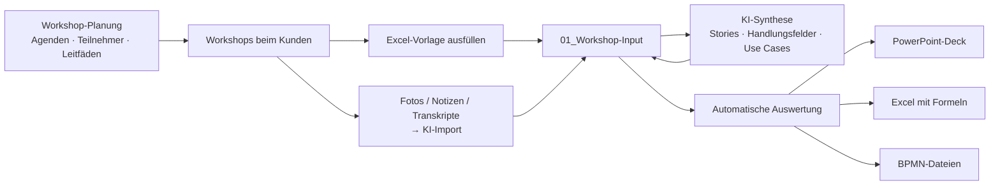

# Digitalisierungsstrategie – KI-gestützter Methodenkoffer

Werkzeug für Digital-Solutions-Beratung in produzierenden Unternehmen: von der **Ist-Analyse** über die
**Synthese** bis zur **Bewertung, Priorisierung und Roadmap**. Sie planen die Workshops, erfassen die
Ergebnisse (per Excel-Vorlage oder per KI aus Fotos/Notizen), und das Tool erzeugt automatisch:

- ein **PowerPoint-Strategiedeck** (Corporate Design, native und editierbare Diagramme, ca. 45 Folien),
- eine **Excel-Auswertung** mit echten Formeln (Nutzwertanalyse, Business Case, Fit-Gap usw. bleiben live änderbar),
- **BPMN-2.0-Dateien** der Ist-Prozesse (für bpmn.io, Camunda, Signavio, ADONIS),
- **Workshop-Unterlagen**: Agenden, Teilnehmervorschläge, Moderationsleitfäden und Erfassungsvorlagen je Workshop.



## Methodenkoffer

| Phase | Methoden-Tools | Automatische Auswertung |
|---|---|---|
| **1 · Ist-Analyse & Problemverständnis** | Stakeholder-Mapping · SIPOC · Prozessaufnahme BPMN/Swimlane · Value Stream Mapping · Pain-Point-Analyse · 5 Whys · Ishikawa · User Stories | Einfluss/Interesse-Matrix mit Strategie und Risiken · Swimlane-Diagramm mit **Medienbruch-Erkennung** · Durchlaufzeit, Flussgrad, RTY, Engpass · Pareto und Heatmap · Fischgräte · **INVEST-Prüfung** und Given/When/Then-Check |
| **2 · Synthese** | User Story Mapping & Handlungsfelder · Use-Case-Steckbriefe · Value Proposition Canvas · Business Model Canvas · Fit-Gap-Analyse | Story Map mit Releases · Potenzial je Handlungsfeld und nicht adressierte Pain Points · Steckbrief-Folien · VPC-Fit-Check · BMC · Fit-Quote und kritische Muss-Gaps |
| **3 · Bewertung, Priorisierung & Roadmap** | Nutzwertanalyse (Kriterien und Scoring) · Impact/Effort · Business Case & ROI · Roadmap Now/Next/Later inkl. MVP und Pilot · RACI | Gewichtetes Ranking mit **Sensitivitätsanalyse** · Quick Wins, Große Vorhaben usw. · Kapitalwert, IRR, ROI, Amortisation · automatischer Roadmap-Vorschlag mit Abhängigkeiten · Gantt · RACI-Prüfung (genau ein A) |

Details zu jeder Methode (Ziel, Ablauf, Material, Erfassungsspalten): [docs/methodenkoffer.md](docs/methodenkoffer.md).
Ein vollständiges Beispiel mit allen Ergebnisdateien liegt unter [examples/](examples/).

## Installation

```bash
git clone https://github.com/dominik-heim/digitalisierungsstrategie.git
```

```bash
cd digitalisierungsstrategie && pip install -e ".[app]"
```

Für die KI-Funktionen wird ein Anthropic-API-Key benötigt (Standardmodell `claude-opus-5-5`, in `projekt.yaml` änderbar):

```bash
export ANTHROPIC_API_KEY="sk-ant-..."
```

## Arbeiten mit der Web-Oberfläche

```bash
digistrat app
```

Die Oberfläche führt Sie durch fünf Schritte: **Projekt → Workshop-Planung → Workshop-Input
(Upload und KI-Import je Methode) → KI-Synthese → Auswertung & Export** mit Download von PPTX, XLSX und BPMN.
Kundenprojekte werden unter `./projekte/` abgelegt; ein anderer Ort lässt sich über `DIGISTRAT_PROJEKTE` setzen.

## Arbeiten mit der Kommandozeile

Beispielprojekt anlegen und komplett auswerten (ohne KI):

```bash
digistrat demo projekte/demo
```

Neues Kundenprojekt anlegen:

```bash
digistrat init projekte/kunde-x --kunde "Kunde X GmbH" --branche "Automotive-Zulieferer" --roadmap-start 2027-Q2
```

Workshop-Serie planen: erzeugt Agenden, Leitfäden und Erfassungsvorlagen, optional mit KI-Leitfragen.

```bash
digistrat workshops projekte/kunde-x --start 2027-01-11 --ki --kontext "Ziel: Liefertreue > 95 %"
```

Flipchart-Fotos und Notizen per KI in ein Methoden-Tool übernehmen:

```bash
digistrat ki-import projekte/kunde-x --methode painpoints --datei fotos/ws2_*.jpg notizen.docx
```

Folge-Artefakte vorschlagen lassen, zum Beispiel User Stories aus Pain Points und Ursachen:

```bash
digistrat ki-ableiten projekte/kunde-x --ziel userstories
```

Eingaben auf Plausibilität prüfen (Pflichtfelder, Wertebereiche, unbekannte IDs, Gewichtssumme):

```bash
digistrat pruefen projekte/kunde-x
```

Alles auswerten und PowerPoint, Excel und BPMN erzeugen (`--ki` formuliert die Management Summary):

```bash
digistrat auswerten projekte/kunde-x --ki
```

## Projektordner

```
projekte/kunde-x/
├── projekt.yaml                  # Kunde, Roadmap-Start, Kalkulationszins, Farbschema, KI-Modell
├── 00_Workshopplanung/
│   ├── workshops.yaml            # Termine, Blöcke, Dauer, Ort – editierbar
│   ├── Workshopplan.xlsx · Workshop-Agenden.pptx
│   ├── Erfassungsvorlagen/       # je Workshop nur die benötigten Methodenblätter
│   └── Moderationsleitfaeden/    # Markdown je Workshop
├── 01_Workshop-Input/
│   ├── Workshop-Erfassung.xlsx   # ein Blatt je Methode, Dropdowns und Hilfetexte
│   ├── KI_<Blatt>.xlsx           # KI-Ergebnisse, vor der Auswertung prüfen
│   └── Rohdaten/                 # Fotos, Transkripte usw.
└── 02_Ergebnisse/
    ├── JJJJ-MM-TT_Digitalisierungsstrategie.pptx
    ├── JJJJ-MM-TT_Auswertung.xlsx
    └── BPMN/*.bpmn
```

Alle `.xlsx`-Dateien in `01_Workshop-Input` werden zusammengeführt. Welche Methode gemeint ist, erkennt das
Tool am **Blattnamen**. Ergebnisse können also auf beliebig viele Dateien verteilt sein, etwa eine je Workshop.

## Verknüpfungslogik

Die Methoden sind über IDs verbunden, die Auswertung baut darauf auf:

`Pain Point (PP-xx)` → `5 Whys` → `User Story (US-xx, Pain-Point-IDs)` → `Handlungsfeld` →
`Use Case (UC-xx, Pain-Point-/Story-IDs)` → `Nutzwertanalyse / Impact-Effort / Business Case` → `Roadmap / RACI`

- **Potenzial eines Handlungsfelds** ist die Summe der Scores (Häufigkeit × Auswirkung) der adressierten Pain Points.
- **Impact und Effort** werden direkt erfasst oder aus der Nutzwertanalyse abgeleitet: Nutzen- und Strategie-Kriterien ergeben den Impact, Machbarkeits- und Risiko-Kriterien den Effort.
- **Roadmap-Vorschlag**: Quick Wins kommen in *Now*, das oberste Viertel der großen Vorhaben in *Now*, die übrigen in *Next*. Lückenfüller landen in *Next*, „Nicht machen“ in *Later* (rot markiert). Abhängigkeiten verschieben den Start.

## Corporate Design

Das Farbschema `ingenics` ist voreingestellt. Die Werte stammen aus den CSS-Variablen von ingenics.com:
Indigo `#152C5A`, Blau `#004F9F`, Cyan `#00AFE9`, Cyan dunkel `#0089D0`, Cyan hell `#83D0F5` und Anthrazit `#F0F0F2`.
Als Schrift ist Arial gesetzt, als Office-Ersatz für Helvetica Now Display. Ändern lässt sich das in `projekt.yaml`:

```yaml
theme:
  preset: ingenics          # oder: neutral
  font: Arial
  pptx_template: vorlagen/Master.pptx   # optional: eigener PowerPoint-Master
  logo: vorlagen/logo.png               # optional
```

## KI und Datenschutz

- Die KI wird nur bei expliziten KI-Befehlen aufgerufen. Die Auswertung selbst ist regelbasiert und läuft offline.
- KI-Ergebnisse landen als eigene `KI_*.xlsx`-Dateien im Input-Ordner und werden vor der Auswertung geprüft (Human in the Loop).
- Strukturierte Ausgaben (JSON-Schema) garantieren, dass die KI exakt die Spalten der Methoden-Tools liefert.
- Kundendaten gehören nicht ins Repository. `projekte/` ist deshalb in `.gitignore` ausgeschlossen.

## Entwicklung

```bash
pip install -e ".[app,dev]"
```

```bash
pytest
```

Neue Methode hinzufügen: in `digistrat/model.py` registrieren (Schema + Methodenkarte), Auswertung in
`analysis.py`, Folie in `report_pptx.py`, Excel-Blatt in `report_excel.py`. Vorlagen, Validierung, KI-Schema und
Workshop-Unterlagen ergeben sich automatisch aus der Registry.
